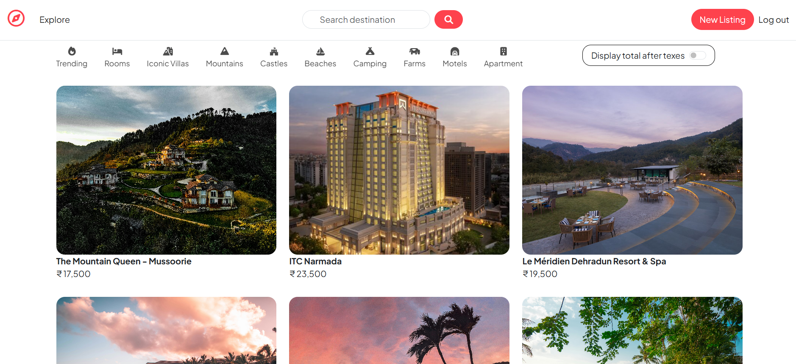
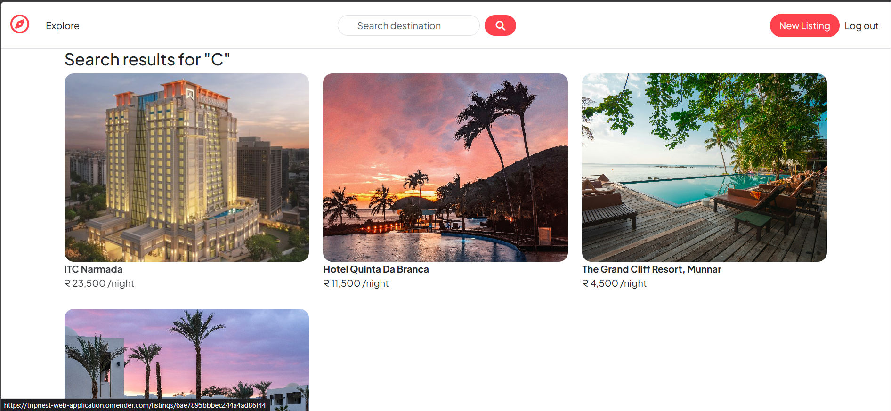
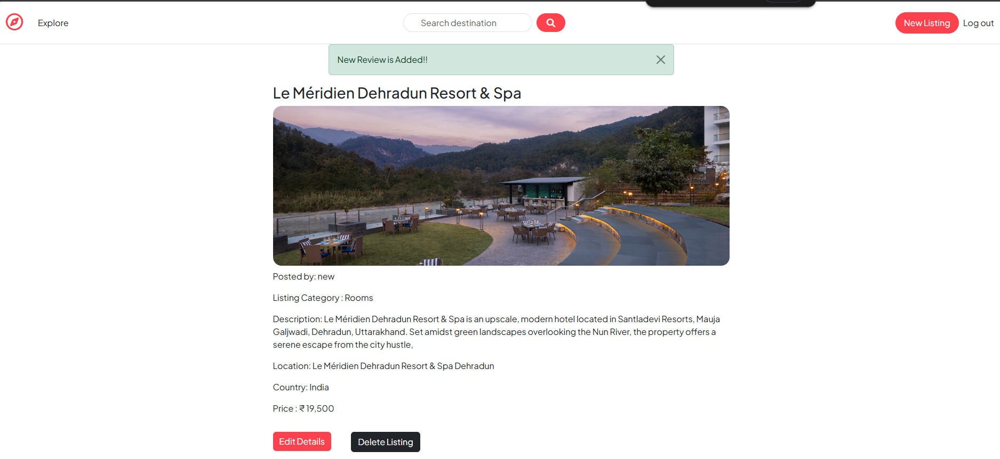
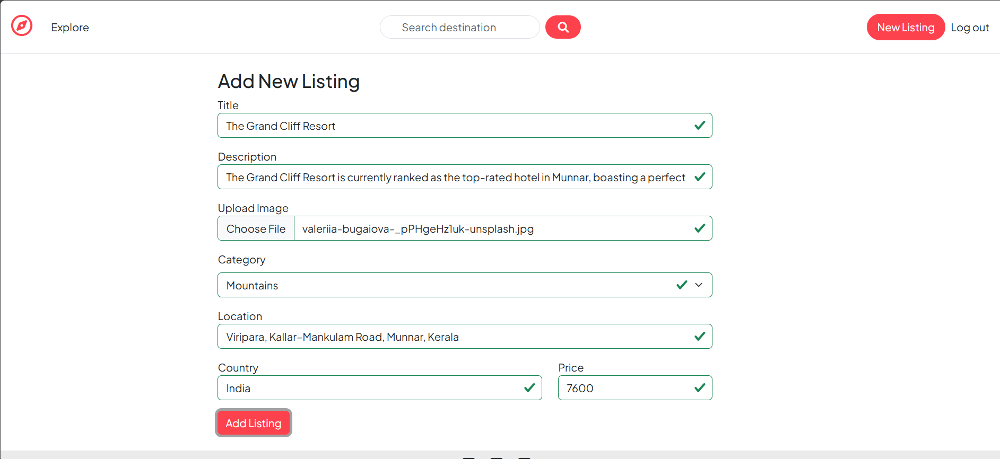
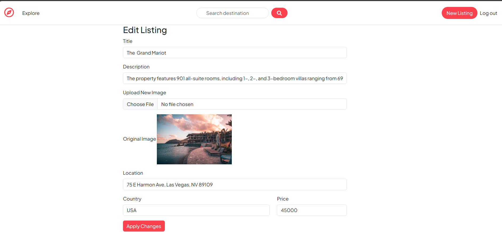
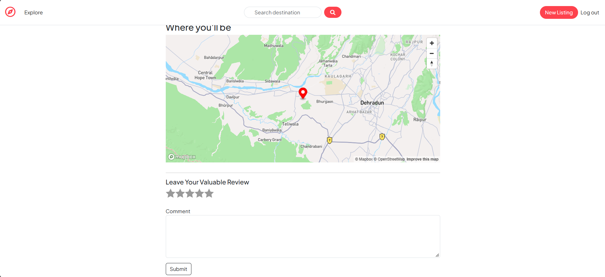
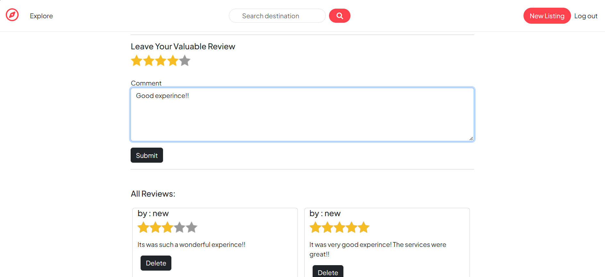
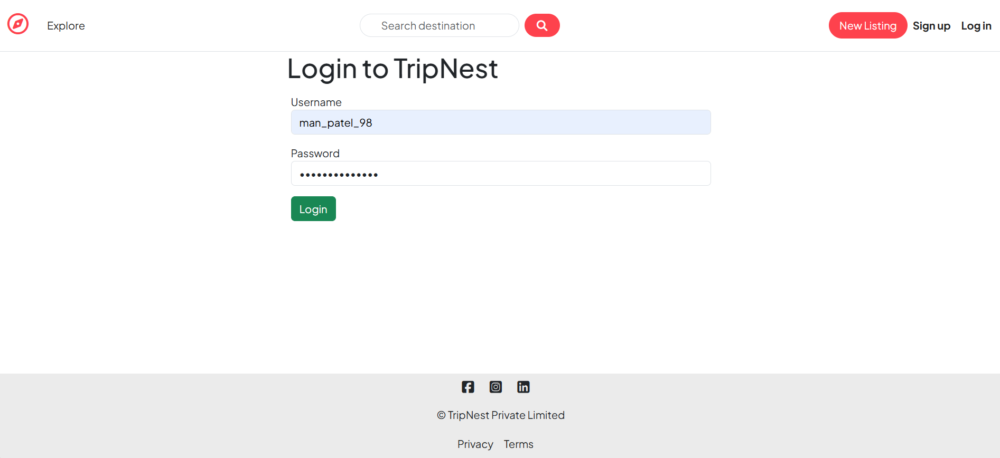
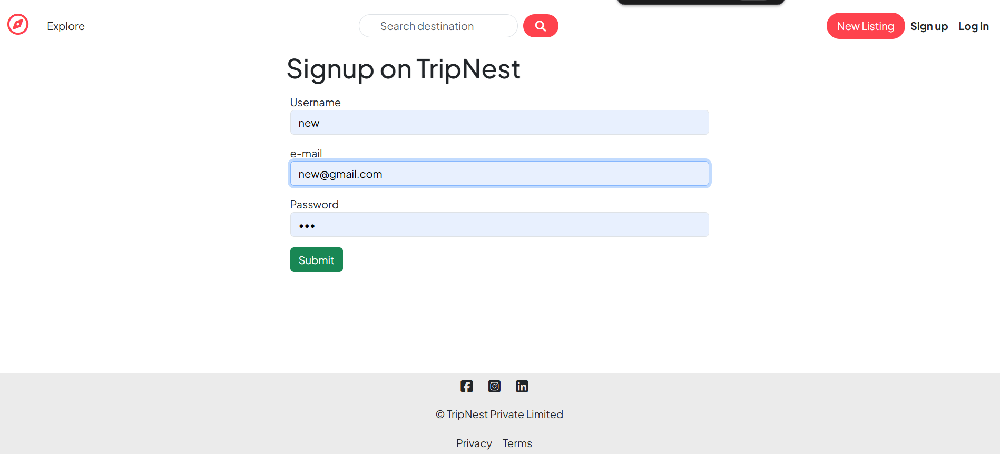
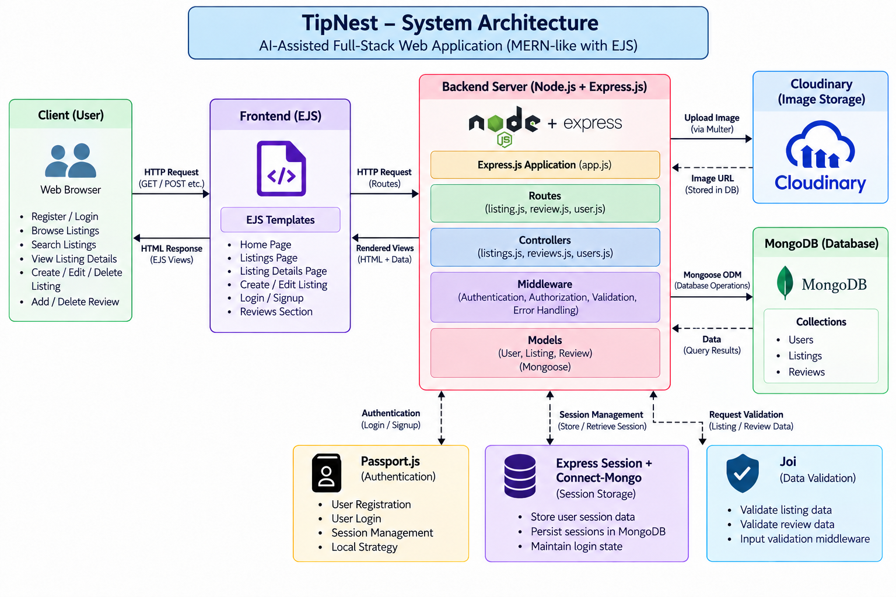

# TripNest_Web_application
TripNest is an Airbnb-inspired platform where users can explore, create, and manage property listings. Built with Node.js, Express.js, MongoDB, and EJS, it includes user authentication, property management, image uploads using Cloudinary, interactive maps with Mapbox, category-based browsing, search functionality, and a review system.

## Live Demo : https://tripnest-web-application.onrender.com [click on explore]

# TripNest

TripNest is an Airbnb-inspired accommodation listing web application. Users can explore available stays, search listings by title, filter by category, create and manage their own listings, upload property images, view locations on an interactive map, and leave reviews.

## Features

- **Browse listings** – View property listings with images, descriptions, prices, and locations.
- **Category filters** – Explore listings by categories such as Rooms, Iconic Villas, Mountains, Castles, Beaches, Camping, Farms, Motels, and Apartments.
- **Search** – Search listings by title.
- **User authentication** – Sign up, log in, and log out using Passport and local authentication.
- **Listing management** – Authenticated users can create listings, edit their own listings, and delete their own listings.
- **Image uploads** – Upload listing images to Cloudinary.
- **Interactive maps** – Display listing locations using Mapbox and coordinates obtained through Mapbox Geocoding.
- **Reviews** – Logged-in users can add reviews and ratings to listings.
- **Flash messages and sessions** – Display success/error messages and persist sessions using MongoDB.

## Screenshots

### 1. All Listings (Shows all listed properties)


### 2. Search Listings (User can search listing based on title-name of the place)


### 3. Listing Details (More inofrmation about listing - Only Owner can edit & delete thier listing)  - (Authorization)


### 4. Add New Listing (Create a new listing - requires SignUp or Login) - (Authentication)


### 5. Edit Listing (User can edit their listing - User can't edit other person's listings) - (Authorization)


### 6. Location Information (Location Information on Show Listing page - Embedded Map Feature)


### 7. User Reviews (Visitors can add the review about the place of visit - Only author can delete their review)


### 8. Login Page (Login Page)


### 9. Signup Page (SignUp Page)


### 10. System Architecture 


## Tech Stack

| Area | Technology |
|---|---|
| Backend | Node.js, Express.js |
| Frontend | EJS, HTML, CSS, JavaScript, Bootstrap |
| Database | MongoDB Atlas, Mongoose |
| Authentication | Passport.js, passport-local, passport-local-mongoose |
| Image storage | Cloudinary, Multer |
| Maps and geocoding | Mapbox GL JS, Mapbox Geocoding SDK |
| Validation | Joi |
| Sessions | express-session, connect-mongo |
| Other middleware | method-override, connect-flash, ejs-mate |

## Getting Started

### Prerequisites

Make sure you have the following installed or configured:

- Node.js (the project specifies Node.js `24.14.1` in `package.json`)
- npm
- A MongoDB Atlas database (or another compatible MongoDB connection)
- A Cloudinary account
- A Mapbox account and access token

### 1. Clone the repository

```bash
git clone https://github.com/man1175/TripNest_Web_application.git
cd TripNest_Web_application
```

### 2. Install dependencies

```bash
npm install
```

### 3. Configure environment variables

Create a `.env` file in the project root for local development. Add your own credentials:

```env
ATLASDB_URL=your_mongodb_connection_string

CLOUD_NAME=your_cloudinary_cloud_name
CLOUD_API_KEY=your_cloudinary_api_key
CLOUD_API_SECRET=your_cloudinary_api_secret

MAP_TOKEN=your_mapbox_access_token
```

Do not commit `.env` or share secret credentials publicly. The deployed service must have the same required variables configured in its hosting provider's environment-variable settings.

### 4. Start the application

```bash
node app.js
```

The application listens on port `8080` in the current project configuration. Open:

```text
http://localhost:8080
```

## Project Structure

```text
PROJECT-1/
├── app.js                  # Express app setup, database connection and middleware
├── cloudConfig.js          # Cloudinary configuration and upload storage
├── controllers/            # Listing, review and user request handlers
├── models/                 # Mongoose models: Listing, Review and User
├── routes/                 # Express routes
├── views/                  # EJS pages and shared layouts
│   ├── includes/           # Navbar, footer and flash messages
│   ├── layouts/            # Main EJS layout
│   ├── listings/           # Listing pages
│   └── users/              # Signup and login pages
├── public/
│   ├── css/                # Stylesheets
│   └── js/                 # Client-side scripts, including the map
├── init/                   # Database initialization data/scripts
├── utils/                  # Async wrapper and custom Express error
├── middleware.js           # Authentication, authorization and validation
├── schema.js               # Joi validation schemas
├── package.json
└── package-lock.json
```

## Main Routes

| Method | Route | Description |
|---|---|---|
| GET | `/listings` | Display listings |
| GET | `/listings/search?q=...` | Search listings by title |
| GET | `/listings/new` | Show the create-listing form (login required) |
| POST | `/listings` | Create a listing (login required) |
| GET | `/listings/:id` | View a listing and its reviews |
| GET | `/listings/:id/edit` | Show the edit form (owner only) |
| PUT | `/listings/:id` | Update a listing (owner only) |
| DELETE | `/listings/:id` | Delete a listing (owner only) |
| POST | `/listings/:id/reviews` | Add a review (login required) |
| DELETE | `/listings/:id/reviews/:reviewId` | Delete a review |
| GET | `/signup` | Show signup page |
| POST | `/signup` | Register a user |
| GET | `/login` | Show login page |
| POST | `/login` | Authenticate a user |
| GET | `/logout` | Log out |

## Deployment

The application can be deployed as a Node.js **Web Service** on a hosting platform such as Render.

Typical Render settings for this project:

- **Build command:** `npm install`
- **Start command:** `node app.js`

Configure the required environment variables in the Render service settings. Ensure the MongoDB Atlas network access rules allow connections from the deployed service.

## Notes

- Listing images are stored in Cloudinary; MongoDB stores the image URL and filename with the listing.
- Listing coordinates are generated through Mapbox Geocoding and used to place the map marker.
- The app currently listens on port `8080` in `app.js`. For platforms that assign a dynamic port, update the server to use `process.env.PORT || 8080`.
- Use only category values supported by the listing model's Mongoose enum. A category value outside that enum will fail listing validation.

## Future Improvements

- Add pagination and more advanced search filters.
- Improve server-side error handling and validation feedback.
- Add automated tests for routes, authentication, and listing operations.
- Use a platform-provided port and a dedicated production session secret.
- Improve accessibility and add more responsive UI refinements.

## Author

**Man Patel**

GitHub: [man1175](https://github.com/man1175)
